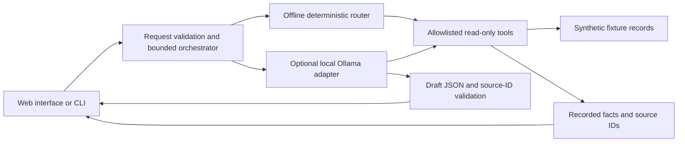

[Project overview](../README.md)

This guide contains the full walkthrough, implementation details, and limitations. Run commands from the repository root.

# Spoke & Spanner — Service Desk Assistant

A local, source-backed assistant for a **fictional bicycle repair shop**. Ask about a repair, inspect the tool results, and review a customer response draft. Every record, policy, price, and identifier is synthetic.

The default mode works offline with a deterministic router. An optional adapter lets an already installed local Ollama model choose from the same read-only tools. This is a portfolio demonstration, not a production service.

## Run in two commands

Requires **Python 3.12 or newer**. No `pip install`, accounts, keys, or downloaded assets.

```shell
cd service-desk-assistant
python app.py serve
```

Open [the local app](http://127.0.0.1:8765). Stop it with Ctrl+C. The app never opens a browser automatically. If the port is occupied, use `python app.py serve --port 8766`.

Or use the CLI:

```shell
python app.py ask "When will R-1042 be ready, and what will it cost?"
```

CLI output is JSON. Exit code `0` means the lookup completed; `2` means clarification, missing evidence, provider failure, or another unresolved state. A completed lookup can still contain explicitly unknown dates or prices; inspect `missing` before using the draft.

## What to try

| Request | Demonstrates |
| --- | --- |
| `When will R-1042 be ready, and what will it cost?` | Repair, part, timing and estimate tools; no invented arrival date |
| `Can I collect R-1043?` | Ready repair plus collection policy |
| `What is the status of the blue bicycle?` | Two matches; choose an exact ticket |
| `What does the warranty cover?` | A policy lookup without a repair |
| `Check R-9999` | Missing record; no draft |
| `Check R-1044` | Missing estimate and an adversarial customer note that cannot add tools |

The interface shows authoritative **recorded facts** with source IDs, unresolved information, the draft, and an expandable trace of every tool call. “Copy draft” copies text locally; it does not send anything.

## Two modes, honestly labeled

**Offline demo (default).** A small deterministic router recognizes ticket IDs, selected bicycle descriptions, and collection/estimate/timing/warranty keywords. It performs real in-process lookups and builds a template from returned facts. It is not an LLM and does not support arbitrary natural-language understanding. The web interface uses loopback HTTP; the offline CLI requires no network access.

**Local model (opt in).** Uses Ollama's native [`POST /api/chat`](https://docs.ollama.com/api/chat) protocol, including `tools`, `message.tool_calls`, and `role: "tool"` replies with `tool_name`, following the [official tool-calling guide](https://docs.ollama.com/capabilities/tool-calling). Calls are non-streaming and use only the loopback server you configure.

If you already have Ollama running with a compatible **local, tool-capable** model installed:

```shell
python app.py serve --model qwen3:4b --timeout 30
```

Then select **Local model · Ollama** in the interface. Substitute the name of your installed model; the example name is a configuration default, not a promise that it is installed or suitable on your hardware. CLI equivalent:

```shell
python app.py ask "Can I collect R-1043?" --mode ollama --model qwen3:4b
```

`--ollama-url http://127.0.0.1:11434` can select another loopback port. Remote URLs, credentials, URL paths, and model names containing `cloud` are rejected. Proxy environment variables and HTTP redirects are not followed. Nothing installs, pulls, or starts a model. You control Ollama's own model configuration: a loopback endpoint alone cannot prove how that separate runtime was configured or whether it forwards inference elsewhere. Use a genuinely local model and runtime configuration.

The request timeout is 1–120 seconds **per model round**, with at most four rounds and six tool executions per question. Unavailable models, malformed output, invalid arguments, and exhausted limits become visible result states. The app never silently changes to offline mode after model failure.

## Architecture and decisions



- `service_assistant/tools.py`: validates tool names and exact argument shapes. No shell, generic file, generic network, email, or mutation tool exists.
- `service_assistant/assistant.py`: shares one orchestration path between HTTP and CLI, preserves tool errors, bounds work, and assembles the evidence independently of the model.
- `service_assistant/providers.py`: small standard-library HTTP adapter with an injectable transport for protocol tests. Duplicate JSON keys, non-finite numbers, deep nesting, malformed Unicode, and oversized responses are rejected.
- `service_assistant/server.py`: loopback binding, fixed static routes, request-size limits, host checks, same-origin checks, a random in-memory request token, and at most two simultaneous assistant requests. It is a development server, not a hardened public gateway.
- `service_assistant/static/`: native accessible controls; user, fixture, and model text enters the DOM through `textContent` or textarea values. No remote scripts, fonts, trackers, or assets.

### Evidence is stronger than a fluent draft

Recorded facts are rendered from tool results. Customer notes stay explicitly labeled as untrusted data and are not automatically promoted to facts. The adversarial fixture is intentional: it asks for a free repair and an unavailable email tool so boundary handling can be demonstrated.

The model's final JSON must contain `draft` and `source_ids` only. A draft without successful evidence, without citations, or citing unread IDs is withheld. **Valid IDs do not prove that every sentence is supported.** Model wording remains unverified and may hallucinate. The interface says this explicitly and requires human review. Prompt instructions are additional guidance, not a security boundary; code-enforced tool restrictions remain effective even if a model obeys an injected note. The tests do not claim general prompt-injection immunity.

## Test

```shell
python -m unittest discover -s tests -v
```

The suite exercises deterministic routing, ambiguity, unknown records, missing evidence, invalid tools/arguments, source validation, injected fixture text, provider failure, loop limits, the actual local HTTP server, origin/header/body checks, and the adapter against a local HTTP stub. It makes no real model or internet calls. Optional JavaScript syntax check: `node --check service_assistant/static/app.js`.

See [VALIDATION.md](../VALIDATION.md) for the exact tested scope and remaining gaps. Browser rendering, keyboard/screen-reader behavior, and live Ollama inference were **not** tested for this build. No production-readiness claim is made.

## Data and provenance

All code and all three repair tickets, two parts, and four policies were created for this original demonstration. No employer code, operational systems, real customer records, source attachments, credentials, or private repository material was used. The shop name is fictional; any resemblance is coincidental. Prices and policies are illustrative, not advice or real shop offers.

No history or business data is written to disk. The browser holds the current result in memory; the server retains only request-time objects and its anti-CSRF token. Questions and tool results are not logged. Selecting a model sends the question and relevant fixtures to the separately running local model process. “Clear workspace” clears the current UI; it is not a promise to erase another process's internal state or the clipboard.

Licensed under [MIT](../LICENSE), copyright Daniel Goetz.
